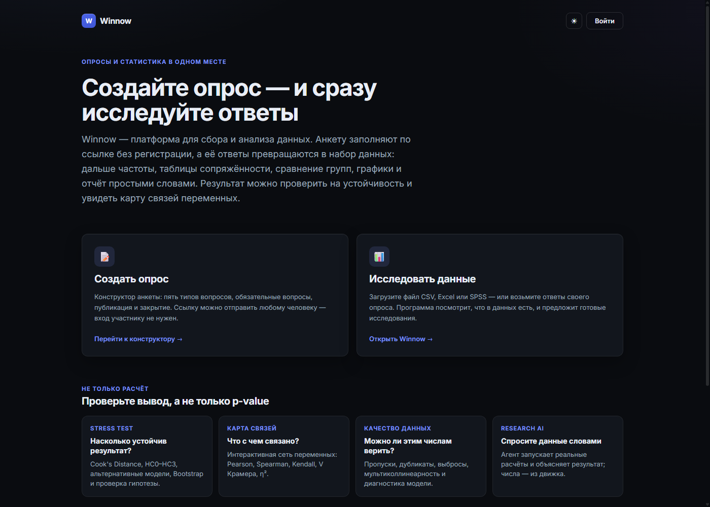
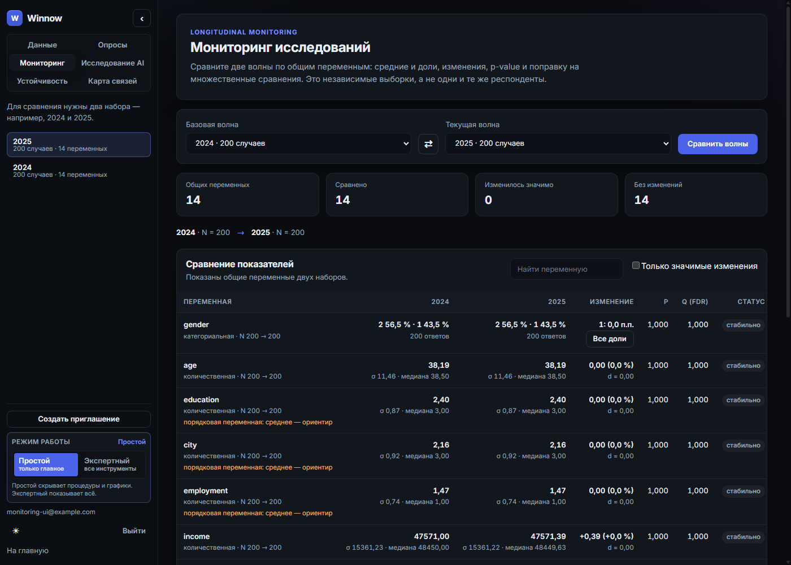
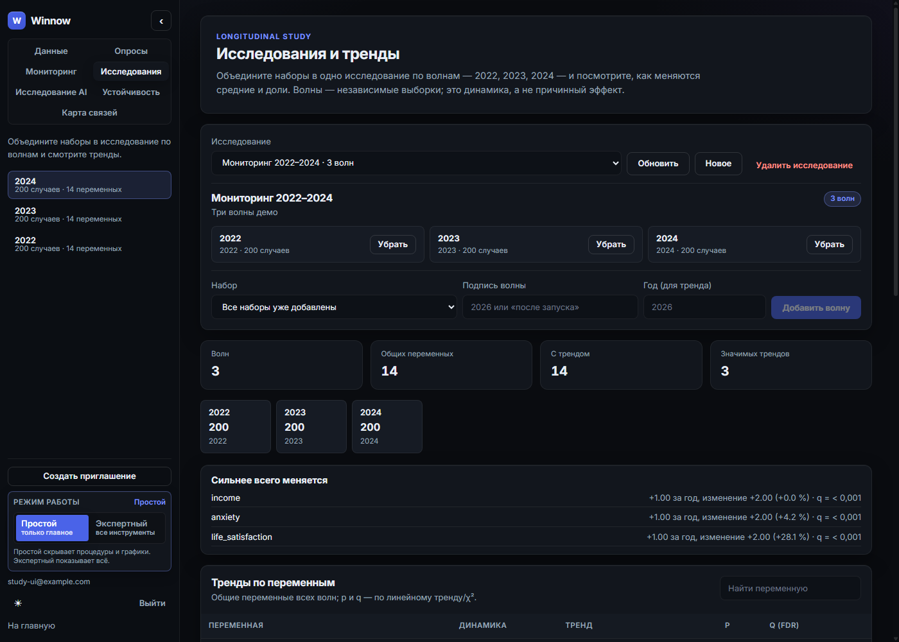
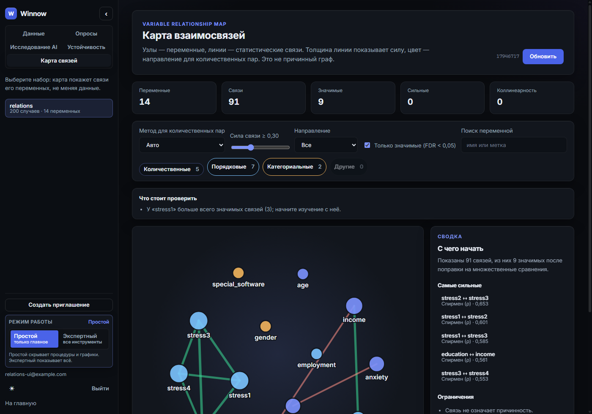
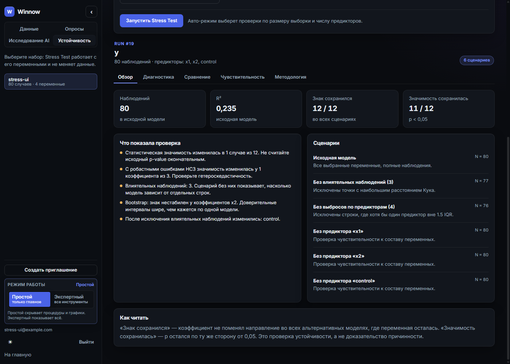

# Winnow

**Веб-платформа для статистического анализа данных в духе SPSS: расчёты, проверка
устойчивости результатов, карта связей и мониторинг исследований год за годом.**



Winnow — не только «ещё один конструктор опросов». Это рабочее место
исследователя: загрузить данные, проверить качество, выбрать метод, получить
отчёт, проверить устойчивость вывода и сравнить волны исследования.

## Возможности

| Блок | Что делает |
|---|---|
| **Данные** | импорт CSV, Excel, SPSS; паспорт переменных, метки, пропуски, правка ячеек |
| **Процедуры** | описательные статистики, частоты, корреляции, таблицы сопряжённости, t-тест, ANOVA, непараметрические тесты, регрессия, факторный анализ, надёжность |
| **Графики** | гистограмма, ящик с усами, столбцы, круговая, диаграмма рассеяния, линия |
| **Качество** | пропуски, дубликаты, выбросы, дисбаланс групп, VIF, Бреуш-Пеган, Кук, остатки |
| **Research Stress Test** | HC0–HC3, влияние наблюдений, спецификации, Bootstrap, Research Challenge |
| **Карта связей** | интерактивная сеть переменных: Pearson/Spearman/Kendall, V Крамера, η², FDR |
| **Мониторинг** | быстрое сравнение двух волн: средние/доли, Welch, χ², изменения |
| **Исследования** | Study → волны → тренды по 3+ волнам, sparkline, таймлайн |
| **Research AI** | агент запускает реальные расчёты через инструменты и объясняет результат |
| **Отчёты** | HTML, Word, Excel; сохранённые расчёты и Stress Test |

### Скриншоты

| Мониторинг волн | Исследования и тренды |
|---|---|
|  |  |

| Карта связей | Stress Test |
|---|---|
|  |  |

## Быстрый старт

Нужны **Python 3.10+**; для сборки интерфейса — **Node.js 20+**.

```powershell
git clone <адрес-репозитория> winnow
cd winnow

python -m venv web\.venv
web\.venv\Scripts\python -m pip install --upgrade pip
web\.venv\Scripts\python -m pip install -e ".[export]"
web\.venv\Scripts\python -m pip install -r web\requirements.txt

cd web\frontend
npm ci
npm run build
cd ..\..

web\run.cmd
```

Приложение откроется на <http://127.0.0.1:8000/>. Остановка — `Ctrl+C` в окне
сервера.

### Переносная версия

Для демонстрации без Python и Node:

```powershell
powershell -ExecutionPolicy Bypass -File tools\build_web_portable.ps1
```

Готовый архив: `dist-web/Winnow-web-portable.zip`. Внутри — `Winnow-web.exe`,
локальный сервер и база рядом с ним. Portable не коммитится в Git; его удобно
прикладывать к GitHub Release.

## Тесты

```powershell
$env:PYTHONPATH = "src"

# движок и аналитические модули
web\.venv\Scripts\python -m pytest tests -q

# API, ИИ, качество, Stress Test, карта, мониторинг
web\.venv\Scripts\python -m pytest web\tests -q

# фронтенд
cd web\frontend
npm run build
npm run lint
```

Текущее состояние: **385 тестов движка и 139 веб-тестов**, все проходят.

## Архитектура

```
src/winnow/
  core/          данные, переменные, метаданные
  stats/         статистические процедуры и Result
  analysis/      quality, stress, relationships, monitoring, trends
  export/        HTML, DOCX, XLSX
  shared/        описания форм и дизайн-токены без интерфейсных зависимостей
  web/           FastAPI, API, хранение, Research AI

web/frontend/    React + TypeScript + Vite
docs/            методика, ограничения, демонстрация
tools/           сборка portable и вспомогательные скрипты
```

Правило проекта: **движок не знает про HTTP, а интерфейс не знает формул**.
Один и тот же `Result` выводится в веб, Word, Excel и HTML.

## Данные и безопасность

- Исходные файлы и база лежат локально; облако не обязательно.
- Пароли — scrypt, сессия в `httpOnly` cookie.
- Ключ ИИ задаётся только переменной окружения на сервере и не попадает во
  фронтенд, логи или Git.
- По умолчанию ИИ видит схему, профиль и агрегаты, а не строки данных.
- Stress Test и мониторинг не меняют исходные данные.

## Ограничения

- Это статистический инструмент, а не доказательство причинности.
- Stress Test и карта связей работают с линейной регрессией и парными связями;
  расширение на логистическую регрессию и другие модели — следующий этап.
- В мониторинге волны считаются независимыми выборками.
- Перед публичным запуском нужны PostgreSQL, HTTPS, резервное копирование и
  юридическая проверка обработки персональных данных.

## Документация

- [Веб-приложение](web/README.md)
- [Research Intelligence](docs/research-intelligence.md)
- [Quality Inspector](docs/quality-inspector.md)
- [Research Stress Test](docs/stress-test.md)
- [Карта взаимосвязей](docs/relationship-map.md)
- [Мониторинг волн](docs/monitoring.md)
- [Исследования и тренды](docs/studies.md)
- [Демонстрация](docs/demo-web.md)
- [Публикация на GitHub](docs/github.md)

## CI

GitHub Actions запускает веб-тесты, сборку и линтер фронтенда:
`.github/workflows/ci.yml`.
